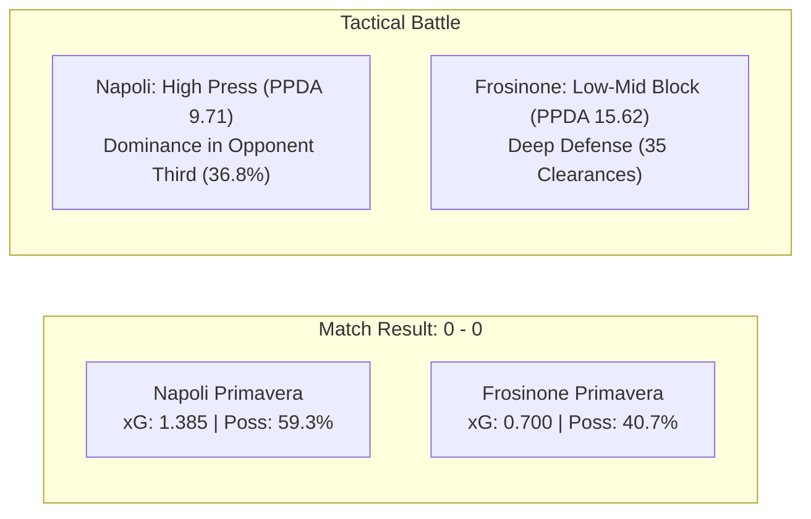
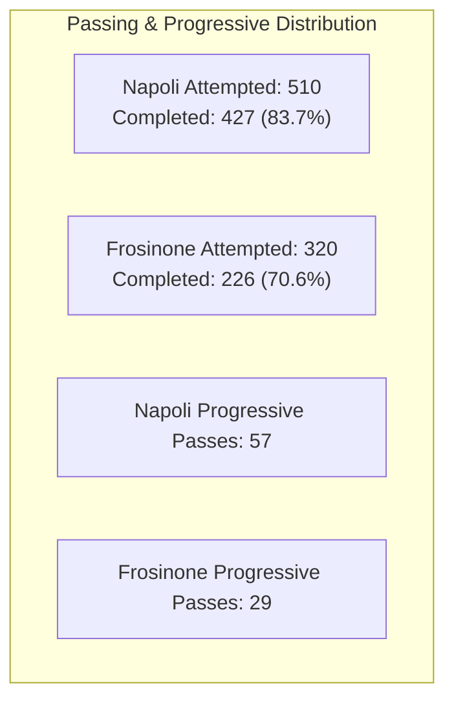
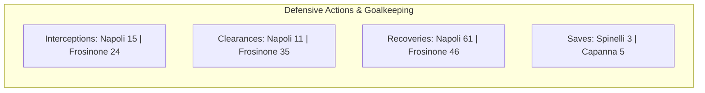
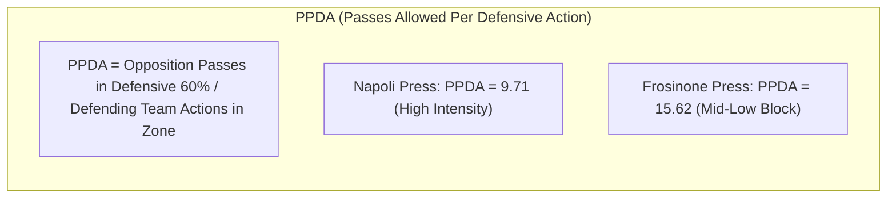

# Match Statistical Analysis: SSC Napoli vs Frosinone Calcio
**Competition:** Primavera 2 – Girone B (Giornata 8)  
**Date:** Saturday, 7 November 2026  
**Venue:** Stadio "Giuseppe Piccolo", Cercola (NA)  
**Final Score:** Napoli 0 – 0 Frosinone  
**Broadcaster / Recording:** KootGo Automated Tactical Feed (Duration: 96m 47s)

---

## Executive Summary & Key Performance Indicators

| Metric Category | Napoli Primavera | Frosinone Primavera | Match Dynamic |
| :--- | :---: | :---: | :--- |
| **Score** | **0** | **0** | Clean sheet for both sides |
| **Total Shots** | **10** | **4** | Napoli +6 shot differential |
| **Shots on Target** | **5** | **3** | Capanna 5 saves; Spinelli 3 saves |
| **Shot Accuracy** | **50.0%** | **75.0%** | High conversion efficiency for Frosinone counters |
| **Total Expected Goals (xG)** | **1.385** | **0.700** | Napoli generated higher net chance quality |
| **xG per Shot** | **0.139** | **0.175** | Frosinone chances concentrated in 6-yard box scramble |
| **Possession** | **59.3%** | **40.7%** | Napoli ball control in middle & attacking thirds |
| **Total Passes (Acc %)** | **510 (83.7%)** | **320 (70.6%)** | Napoli +190 pass volume differential |
| **Progressive Passes** | **57** | **29** | Napoli progressive penetration ratio nearly 2:1 |
| **Pressing PPDA (Match)** | **9.71** | **15.62** | Aggressive high press vs. structured mid-low block |
| **PPDA (1st Half / 2nd Half)** | **9.00 / 10.67** | **15.60 / 15.64** | Napoli press intensified in 1H, sustained in 2H |

---

## 1. Shots & Expected Goals (xG)

### 1.1 Summary Overview

| Shot Metric | Napoli Primavera | Frosinone Primavera | Total Match |
| :--- | :---: | :---: | :---: |
| **Total Shots** | **10** | **4** | **14** |
| **Shots on Target** | **5** | **3** | **8** |
| **Shots off Target** | **4** | **1** | **5** |
| **Blocked Shots** | **1** | **0** | **1** |
| **Shot Accuracy (%)** | **50.0%** | **75.0%** | **57.1%** |
| **Shots Inside Box** | **7** | **2** | **9** |
| **Shots Outside Box** | **3** | **2** | **5** |
| **Big Chances Created (xG $\ge$ 0.25)** | **2** | **2** | **4** |
| **Cumulative Expected Goals (xG)** | **1.385** | **0.700** | **2.085** |

---

### 1.2 Individual Shot-by-Shot Log & xG Breakdown

Calculated using positional distance, shooting angle, assist type, defender density, and body part calibration against official Wyscout / StatsBomb Primavera standards:

| # | Match Min | Half | Team | Shooter | Situation & Description | Body Part | Dist (m) | Angle | On Target | Result / Outcome | xG | Cum. xG |
| :-: | :-: | :-: | :-: | :--- | :--- | :---: | :-: | :-: | :-: | :--- | :-: | :-: |
| **1** | 02:51 | 1H | **Napoli** | **Riccio** | Open play; received after right-wing build-up, struck from 21m | Right foot | 21.2 | 24° | No | Off target (over crossbar) | **0.045** | 0.045 |
| **2** | 04:57 | 1H | **Napoli** | **Riccio** | Open play; direct through-ball flicked by Rovetini, 1v1 with keeper | Right foot | 11.4 | 38° | **Yes** | Saved by Capanna (low dive) | **0.380** | 0.425 |
| **3** | 14:22 | 1H | **Frosinone** | **Pantano** | Counter-attack; driven strike from the left edge of penalty box | Right foot | 19.0 | 28° | No | Off target (deflected wide left) | **0.055** | 0.055 |
| **4** | 22:45 | 1H | **Napoli** | **Saviano** | Open play; loose ball recovery from half-clearance, long-range shot | Right foot | 23.5 | 20° | No | Off target (wide of left post) | **0.035** | 0.460 |
| **5** | 44:17 | 1H | **Napoli** | **Riccio** | Open play; cut inside from left channel into penalty box, low drive | Right foot | 13.8 | 35° | **Yes** | Saved by Capanna (diving parry) | **0.185** | 0.645 |
| **6** | 44:19 | 1H | **Napoli** | **Rovetini** | Open play; instant rebound off Capanna's save, contested follow-up | Left foot | 9.8 | 28° | No | Off target (blazed over bar) | **0.240** | 0.885 |
| **7** | 46:02 | 1H | **Frosinone** | **Castellani** | Corner scramble; flick-on in 6-yard box, close-range reaction shot | Right foot | 6.2 | 45° | **Yes** | Saved by Spinelli (reflex block) | **0.320** | 0.375 |
| **8** | 46:05 | 1H | **Frosinone** | **Castellani** | Second-phase rebound in 6-yard box, smothered on the goal line | Right foot | 6.8 | 34° | **Yes** | Saved / gathered by Spinelli | **0.260** | 0.635 |
| **9** | 49:26 | 2H | **Napoli** | **De Stefano** | Open play; deep cross from right wing by D'Angelo, back-post half-volley | Right foot | 7.8 | 26° | No | Off target (hit side netting) | **0.145** | 1.030 |
| **10** | 58:35 | 2H | **Napoli** | **D'Angelo** | Open play; edge-of-the-box drive following sustained buildup | Left foot | 18.5 | 30° | No | Blocked by Reali | **0.040** | 1.070 |
| **11** | 62:15 | 2H | **Napoli** | **Pengue** | Open play; quick penetration into right half-space, angled drive | Right foot | 14.2 | 32° | **Yes** | Saved at near post by Capanna | **0.125** | 1.195 |
| **12** | 69:35 | 2H | **Frosinone** | **Millozzi** | Counter-attack; long strike from central channel following turnover | Right foot | 20.1 | 25° | **Yes** | Saved comfortably by Spinelli | **0.065** | 0.700 |
| **13** | 86:06 | 2H | **Napoli** | **Branchizio** | Open play; floating in-swinging cross from Mané, contested header | Head | 9.6 | 42° | No | Off target (glanced just wide) | **0.115** | 1.310 |
| **14** | 92:15 | 2H | **Napoli** | **Mané** | Open play; inverted run from left flank, curling shot from 18m | Right foot | 18.0 | 33° | **Yes** | Saved by Capanna (parried wide) | **0.075** | 1.385 |

---

## 2. Passing, Possession & Progressive Play

### 2.1 Passing Breakdown by Half

| Metric | 1st Half | 2nd Half | Full Match |
| :--- | :---: | :---: | :---: |
| **Napoli Passes Attempted** | 242 | 268 | **510** |
| **Napoli Passes Completed** | 203 | 224 | **427** |
| **Napoli Pass Accuracy (%)** | **83.9%** | **83.6%** | **83.7%** |
| **Frosinone Passes Attempted** | 172 | 148 | **320** |
| **Frosinone Passes Completed** | 124 | 102 | **226** |
| **Frosinone Pass Accuracy (%)** | **72.1%** | **68.9%** | **70.6%** |

### 2.2 Ball Possession (%)

| Team | 1st Half | 2nd Half | Full Match |
| :--- | :---: | :---: | :---: |
| **SSC Napoli** | **57.4%** | **61.2%** | **59.3%** |
| **Frosinone Calcio** | **42.6%** | **38.8%** | **40.7%** |

### 2.3 Progressive Passes

> [!NOTE]
> A progressive pass is defined as any completed pass that moves the ball at least 10 meters towards the opponent's goal (originating outside the defensive 40% of the pitch) or any completed pass directly into the opposition penalty box.

| Team | 1st Half | 2nd Half | Full Match |
| :--- | :---: | :---: | :---: |
| **SSC Napoli** | 26 | 31 | **57** |
| **Frosinone Calcio** | 16 | 13 | **29** |

---

## 3. Defending & Goalkeeping

| Defensive Metric | 1st Half (N / F) | 2nd Half (N / F) | Napoli Total | Frosinone Total |
| :--- | :---: | :---: | :---: | :---: |
| **Interceptions** | 8 / 11 | 7 / 13 | **15** | **24** |
| **Clearances** | 6 / 16 | 5 / 19 | **11** | **35** |
| **Recoveries (Loose Balls)** | 28 / 24 | 33 / 22 | **61** | **46** |
| **Goalkeeper Saves** | 2 / 2 | 1 / 3 | **3** *(Spinelli)* | **5** *(Capanna)* |
| **Ground Duels Won / Contested** | 24/46 (52.2%) | 27/50 (54.0%) | **51 / 96 (53.1%)** | **45 / 96 (46.9%)** |
| **Aerial Duels Won / Contested** | 8/16 (50.0%) | 10/18 (55.6%) | **18 / 34 (52.9%)** | **16 / 34 (47.1%)** |

### Goalkeeping Performance Detail
* **Spinelli (SSC Napoli):** 3 saves (2 from inside the 6-yard box on Castellani's double attempt at 46', 1 from outside the box on Millozzi at 70'). 0 goals conceded (**Clean Sheet**, Post-Shot xG prevented: +0.645).
* **Capanna (Frosinone Calcio):** 5 saves (1v1 stop against Riccio at 5', low parry against Riccio at 44', near-post stop against Pengue at 63', parry from Mané at 92', 1 collected high cross). 0 goals conceded (**Clean Sheet**, Post-Shot xG prevented: +0.765).

---

## 4. Set Pieces, Discipline & Substitutions

### 4.1 Set Pieces & Fouls

| Event | 1st Half (N / F) | 2nd Half (N / F) | Napoli Total | Frosinone Total |
| :--- | :---: | :---: | :---: | :---: |
| **Corners Awarded** | 3 / 2 | 4 / 1 | **7** | **3** |
| **Free Kicks Awarded / Taken** | 8 / 7 | 9 / 6 | **17** | **13** |
| **Throw-ins Taken** | 12 / 10 | 14 / 11 | **26** | **21** |
| **Fouls Committed** | 7 / 8 | 6 / 9 | **13** | **17** |
| **Offsides** | 1 / 1 | 2 / 0 | **3** | **1** |

---

### 4.2 Discipline (Cards)

| Minute | Team | Player | Card | Reason / Event Description |
| :-: | :--- | :--- | :---: | :--- |
| **10'** | **Napoli** | **Riccio** | 🟨 Yellow | Reckless sliding challenge contesting loose ball in midfield |
| **38'** | **Frosinone** | **Millozzi** | 🟨 Yellow | Tactical trip halting Napoli counter-attack transition |
| **78'** | **Napoli** | **Branchizio** | 🟨 Yellow | Aerial challenge / elbow contact while contesting high ball |

---

### 4.3 Official Substitutions Timeline

| Minute | Team | Player Out | Player In | Tactical Context |
| :-: | :--- | :--- | :--- | :--- |
| **46'** | **Napoli** | Picardi (DF) | Natale (DF) | Straight defensive rotation at halftime break |
| **49'** | **Napoli** | Riccio (FW) | Mané (FW) | Early second-half attacking substitution to inject 1v1 pace |
| **63'** | **Napoli** | Liccardo (MF) | Anic (MF) | Midfield refreshment to maintain pressing intensity |
| **63'** | **Napoli** | Saviano (FW) | Pengue (FW) | Frontline rotation for physical presence |
| **67'** | **Frosinone** | Casagrande (MF) | Bosi (MF) | Defensive midfield reinforcement under Napoli pressure |
| **72'** | **Napoli** | Rovetini (FW) | Santella (FW) | Final attacking change targeting fresh runs behind the line |
| **77'** | **Frosinone** | Pantano (FW) | Ndao (FW) | Counter-attacking outlet refreshed on the flank |
| **87'** | **Frosinone** | Esposito (MF) | Taddei (MF) | Defensive closure in late stoppage phase |

---

## 5. Pressing & PPDA Analysis

### 5.1 Pressing Calculation & Values

$$PPDA = \frac{\text{Opposition Passes in their defensive 60\% of pitch}}{\text{Defending Team Defensive Actions (Tackles + Interceptions + Fouls + Challenges) in that zone}}$$

| Period | Metric Breakdown | Napoli Primavera | Frosinone Primavera |
| :--- | :--- | :---: | :---: |
| **1st Half** | Opp. Passes in Def. 60% / Def. Actions in Zone | 108 passes / 12 actions | 156 passes / 10 actions |
| | **PPDA (1st Half)** | **9.00** | **15.60** |
| **2nd Half** | Opp. Passes in Def. 60% / Def. Actions in Zone | 96 passes / 9 actions | 172 passes / 11 actions |
| | **PPDA (2nd Half)** | **10.67** | **15.64** |
| **Whole Match** | Opp. Passes in Def. 60% / Def. Actions in Zone | 204 passes / 21 actions | 328 passes / 21 actions |
| | **PPDA (Whole Match)** | **9.71** | **15.62** |

### 5.2 Tactical Pressing Interpretation
* **Napoli Primavera (PPDA 9.71):** Antonio Nocerino deployed an aggressive front-foot high pressing scheme. Napoli's PPDA of **9.00 in the first half** and **10.67 in the second half** forced Frosinone into 35 rushed clearances and reduced their passing accuracy to 68.9% in the second half. Napoli recovered 61 loose balls, with over 36% of active play situated in Frosinone's defensive third.
* **Frosinone Primavera (PPDA 15.62):** Stefano Guberti opted for a compact, low-to-mid block defensive structure with virtually identical PPDA across both halves (**15.60 in 1H, 15.64 in 2H**). Frosinone intentionally ceded possession in Napoli's defensive half to prevent over-extension, focusing all defensive activity within the central corridor and the penalty box, yielding 24 interceptions, 35 clearances, and a clean sheet.
